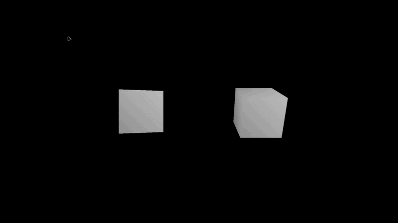

# BFGE

**BFGE — компактный 3D-движок на Rust для настольных приложений.** Проект
объединяет загрузку моделей, подготовку сцены и вывод изображения в окно.
Основной акцент — на полном пути от данных модели до готового кадра: организации
объектов в сцене, обновлении их состояния и передаче геометрии для отображения.
BFGE подходит для прототипирования 3D-сцен, учебных экспериментов и изучения
архитектуры графических приложений на Rust.



## Использование из приложения

BFGE подключается как библиотека и предоставляет публичный API для управления
движком и сценой. Через него можно создавать иерархию сцены, загружать модели,
настраивать точку обзора и освещение, а также обновлять состояние на каждом
кадре. Оконная сессия запускается отдельно от подготовки сцены: сначала
настраивается содержимое, затем создаётся окно и запускается цикл кадров.

Типичный порядок работы:

1. Создать экземпляр движка и подготовить сцену.
2. При необходимости зарегистрировать обработчики кадров для анимации и
   обновления сцены.
3. Инициализировать движок с параметрами окна и запустить цикл кадров.
4. После завершения цикла закрыть оконную сессию.

Подключение, примеры и подробности доступны в
[руководстве пользователя](docs/user-guide.md). Перечень действий и их поведения
приведён в [справочнике API](docs/api.md); полные сигнатуры методов доступны в
Rustdoc.

## О проекте

- Сцена организована как иерархия узлов и размещённых в ней объектов.
- Узлы задают положение, поворот и масштаб; объекты используют геометрию моделей.
- Точка обзора и освещение настраиваются для всей сцены.
- Сцена и геометрия подготавливаются до открытия окна, а затем используются в
  цикле кадров.
- Перед отображением движок обходит дерево сцены, рассчитывает итоговые
  преобразования объектов и формирует данные кадра.
- Геометрия хранится отдельно от объектов. Один меш может совместно
  использоваться несколькими объектами, а графические буферы повторно
  применяются между кадрами.
- Графическая часть создаёт изображение в оконной поверхности и обрабатывает
  изменение её размера в течение сессии.

В основе проекта лежат следующие технологии:

- **Rust** — язык реализации движка и примеров.
- **wgpu** — графический API для передачи геометрии и команд отображения GPU.
- **glam** — векторные и геометрические вычисления сцены.
- **gltf** и **tobj** — чтение моделей glTF 2.0 / GLB и OBJ.
- **Serde и JSON** — конфигурации и отчёты нагрузочных экспериментов.

## Возможности

- Импорт статических моделей OBJ, glTF 2.0 и GLB.
- Иерархическая организация сцены с наследованием положения, поворота и масштаба.
- Перспективная камера с настраиваемым положением и направлением взгляда.
- Общее фоновое и направленное освещение.
- Обработчики начала и конца кадра для изменения сцены во время работы.
- Снимок сцены в памяти движка с восстановлением между оконными сессиями.
- Отображение в настольном окне через графический backend на `wgpu`.

## Демонстрационные сцены

Примеры показывают возможности движка на небольших самостоятельных приложениях.

| Пример | Содержание |
| --- | --- |
| `rotating_model` | Загрузка модели и анимация вращения. |
| `lighting_demo` | Изменение направленного освещения на сцене с геометрическими объектами. |
| `showcase` | Сетка из множества объектов и перемещение камеры между сценами. |
| `city_flyover` | Пролёт над городом и изменение освещения. |
| `spiral_sculpture` | Вращение спиральной скульптуры с цветными элементами. |
| `depth_corridor` | Движение через коридор из арок с заметной глубиной сцены. |

Команды запуска, требования к графической среде и более подробное описание
сцен находятся в [README каталога примеров](examples/README.md).

## Краткий запуск

Для сборки требуется Rust 1.95.0. Для оконного запуска необходимы графическая
сессия и доступный графический адаптер.

```bash
git clone https://github.com/BFGEG/BFGE.git
cd BFGE
cargo run --release --locked --example showcase
```

Команда запускает сцену с множеством объектов и перемещением камеры. Для
отображения отдельной модели используется `rotating_model`; путь к OBJ, glTF
или GLB передаётся после `--`:

```bash
cargo run --locked --example rotating_model -- path/to/model.gltf
```

## Нагрузочные эксперименты

В проект входят профили для сравнения сцен с разным числом объектов и мешей,
а также с различной структурой узлов. В опубликованном прогоне на Intel Core
Ultra 7 155H и Intel Arc Graphics уровень в 2 000 объектов прошёл критерий
60 FPS, а уровень в 3 000 объектов — нет. Это результат конкретного стенда,
разрешения и режима синхронизации, а не универсальная оценка производительности.
Методика и остальные результаты собраны в
[описании экспериментов](benchmark/experiments.md).

## Документация

- [Руководство пользователя](docs/user-guide.md) — устройство сцены, загрузка моделей, камера, освещение и обработчики.
- [Архитектура](docs/architecture.md) — жизненный цикл и путь данных кадра.
- [Возможности API](docs/api.md) — действия, доступные клиентскому приложению.
- [Отображение сцены](docs/graphics.md) — подготовка графической системы и проход отображения.
- [Карта модулей](docs/modules.md) — назначение частей исходного кода.
- [Требования](docs/requirements.md) — цель и проверяемое поведение BFGE.
- [Запуск бенчмарков](benchmark/README.md) — профили и команды измерений.
