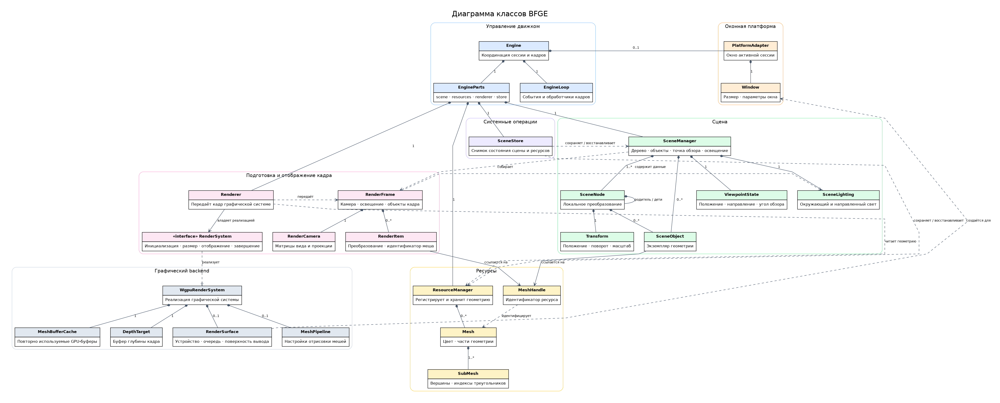

# Архитектура BFGE

BFGE — оконный движок для построения, изменения и отображения одной 3D-сцены.
Клиент задаёт содержимое сцены через публичный интерфейс, а движок управляет
окном, циклом кадров и передачей подготовленной сцены графическому backend.
Документ описывает устройство текущей реализации версии 0.1.0.

## Состав системы

Диаграмма показывает основные сущности текущей реализации, их владение и
связи между подсистемами. Исходник изображения находится в
[`architecture.dot`](architecture.dot). Внутренние детали реализации, не
влияющие на устройство системы, на схеме не приведены.

| Часть | Ответственность |
| --- | --- |
| Клиент | Создаёт движок, подготавливает сцену и задаёт поведение кадров. |
| Управление движком | Связывает публичные запросы, жизненный цикл, обработчики кадров и подсистемы. |
| Сцена | Хранит узлы, объекты, точку обзора и освещение. |
| Ресурсы | Хранят CPU-геометрию моделей, используемую объектами сцены. |
| Системы | Загружают модели, сохраняют и восстанавливают снимок, запускают и завершают подсистемы. |
| Подготовка кадра | Вычисляет преобразования узлов в координатах сцены и формирует данные для отображения. |
| Отображение | Получает геометрию ресурсов, передаёт команды графическому устройству и показывает кадр в окне. |

Сцена и ресурсы принадлежат экземпляру движка. Сцена хранит ссылки на модели
по идентификаторам ресурсов, а геометрия остаётся в менеджере ресурсов. Это
позволяет многим объектам использовать один ресурс, когда он создан как общий.
Публичный загрузчик модели создаёт новый ресурс при каждом успешном вызове.
Операция `clone_object` создаёт экземпляр с тем же ресурсом. При удалении
объекта его слот остаётся пустым, поэтому ID других объектов сохраняются,
а удалённый ID не выдаётся новому объекту. Узлы и ресурсы при этом остаются.

## Организация кода

Подробное распределение обязанностей по исходным каталогам приведено в
[карте модулей](modules.md). На уровне архитектуры ключевая граница проходит
между состоянием сцены и графическими объектами.

Публичная структура данных отделена от графических объектов. Узлы и объекты
сцены содержат CPU-состояние; графические буферы создаются лениво при первом
использовании ресурса и хранятся в кэше backend. Поэтому построить сцену и
загрузить модели можно до открытия окна.

## Сцена и преобразования

Сцена содержит корневой узел и дерево дочерних узлов. Каждый узел задаёт
перенос, поворот и масштаб. Объект сцены привязан к одному узлу и наследует его
итоговое преобразование. Точка обзора не входит в дерево и настраивается отдельно.

При подготовке кадра движок обходит дерево от корня к листьям. Итоговое
преобразование дочернего узла получается применением локального преобразования
к уже вычисленному преобразованию родителя. Для каждого объекта в кадр попадают
его итоговое положение, поворот и масштаб в координатах сцены, а также
идентификатор меша. Геометрия остаётся в ресурсах и извлекается backend при
отрисовке.

Правая система координат использует `+Y` как направление вверх. Локальное
преобразование применяет масштаб, поворот и перенос. Камера формирует
перспективную проекцию с ближней и дальней плоскостями на 0.1 и 100 единицах.

## Жизненный цикл

Движок создаёт CPU-состояние до открытия окна. Это позволяет подготовить сцену
и зарегистрировать обработчики заранее.

1. **Создание.** Создаётся экземпляр движка с корневым узлом, точкой обзора и
   начальными настройками освещения.
2. **Инициализация.** Движок создаёт окно, выбирает графический адаптер и
   настраивает поверхность. Сцена, созданная до этого шага, сохраняется.
3. **Запуск.** `run()` обрабатывает события окна и выполняет кадры, пока окно не
   закрыто или не произошла ошибка. Вызов блокирует текущий поток.
4. **Завершение сессии.** После возврата из `run()` клиент вызывает `shutdown()`.
   Окно и состояние сцены сбрасываются; снимок и зарегистрированные обработчики
   остаются внутри экземпляра движка.

Для следующего показа тот же экземпляр движка инициализируют повторно. Сцена
будет новой, если клиент не восстановит сохранённый снимок. Идентификаторы узлов
и объектов из прежней сессии не предназначены для повторного использования.

## Работа одного кадра

Каждый кадр проходит фиксированную последовательность:

1. Движок обрабатывает события окна. Закрытие останавливает цикл; изменение
   размера применяется до построения следующего кадра.
2. Вызываются обработчики начала кадра в порядке регистрации. Их изменения сцены
   учитываются в кадре, который собирается сразу после них.
   Каждый обработчик получает контекст с заимствованием сцены и ресурсов:
   `scene()` предоставляет операции сцены, `load_model()` — синхронную загрузку.
3. Сцена обходит дерево узлов и собирает состояние объектов, камеры и света.
4. Renderer разрешает идентификаторы мешей в CPU-геометрию и передаёт данные
   backend. Backend создаёт GPU-буферы при первом использовании меша и повторно
   использует их в следующих кадрах.
5. Backend отображает геометрию в окне. После успешного прохода вызываются
   обработчики конца кадра.

Если размер окна нулевой, обработчики и отрисовка приостанавливаются до
восстановления ненулевого размера. Временный пропуск кадра из-за перекрытия или
тайм-аута получения поверхности не считается ошибкой; обработчики конца кадра
при этом вызываются. Ошибка обработки сцены или графического backend завершает
текущий запуск с ошибкой.

## Загрузка модели

Загрузчик поддерживает OBJ, glTF 2.0 и GLB. Он читает файл, проверяет геометрию,
добавляет новый ресурс и создаёт один объект сцены, привязанный к выбранному
узлу. Если чтение или проверка завершается ошибкой, сцена и список ресурсов
остаются прежними. Повторная загрузка того же файла создаёт отдельный объект и
отдельный ресурс.

Во время `run()` тот же загрузчик доступен через `FrameContext`. Загрузка в
начале кадра добавляет модель в текущий кадр, в конце — в следующий. Удаление,
создание экземпляров и изменение преобразований следуют тем же правилам.
Ошибка загрузчика сохраняет причину в `EngineError::ModelLoad` и завершает цикл.

Составная модель становится одним объектом с несколькими частями геометрии.
Для модели выбирается общий цвет из используемых материалов. Подробности
поддерживаемых форматов приведены в
[руководстве пользователя](user-guide.md#загрузка-моделей).

## Снимок сцены

Снимок позволяет сохранить текущее состояние сцены в памяти движка и позже
вернуть его, например, после завершения и повторного открытия окна.

1. При сохранении движок копирует CPU-состояние дерева, объектов, всех
   зарегистрированных ресурсов, камеры и освещения. Новый снимок заменяет
   предыдущий.
2. При восстановлении движок сначала проверяет, что в текущей сцене нет
   объектов. Если она занята, операция завершается ошибкой без изменений.
3. При свободной сцене сохранённое состояние проверяется и целиком заменяет
   текущие данные. Если снимка нет, восстановление пустой сцены ничего не меняет.

Снимок не является файлом: он существует только в памяти экземпляра движка.
Данные окна, GPU-кэш и обработчики кадров в него не входят. Обработчики живут
отдельно и сохраняются при завершении сессии.

## Связанные документы

Расположение частей исходного кода приведено в [карте модулей](modules.md).
Доступные клиенту действия описаны в [обзоре API](api.md), требования к системе —
в [документе требований](requirements.md), а детали вывода изображения — в
[описании графического слоя](graphics.md).
